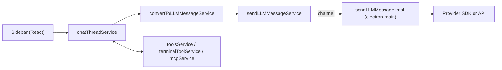

# Kodia Codebase Guide

Kodia is a fork of [VS Code](https://github.com/microsoft/vscode), by way of [Void](https://github.com/voideditor/void). Most of Kodia's own code lives in `src/vs/workbench/contrib/void/`. The folder keeps its Void name so upstream merges stay simple.

This guide explains how that code fits together. To build and run Kodia, see [HOW_TO_CONTRIBUTE.md](HOW_TO_CONTRIBUTE.md).

## Where things live

| Path | What it is |
|---|---|
| `src/vs/workbench/contrib/void/` | Kodia's features: chat sidebar, Apply, Ctrl+K, autocomplete, settings, tools, MCP. |
| `src/vs/workbench/contrib/void/browser/react/` | The React UI (sidebar, settings, onboarding, Ctrl+K, tooltips), bundled separately. |
| `src/vs/workbench/contrib/void/test/` | Unit tests (`npm run test-void`). |
| `src/vs/platform/agentHost/node/mistral/` | The Mistral agent for the Agents window. |
| `scripts/void/` | Maintenance scripts, such as the model catalog check. |
| `.github/workflows/` | CI: `pr-checks.yml` on every pull request, `model-catalog.yml` weekly. |

Everything else is VS Code. Kodia also changes some VS Code files. Mark each such change with a `Kodia:` comment saying why, so it's easy to find and keep during upstream merges. VS Code's chat features that Kodia replaces are switched off behind an `isVoidEditor` check (see `chat.shared.contribution.ts`).

## VS Code basics

VS Code is an Electron app with two kinds of processes:
- **main**: the app's internals, with Node and `node_modules`;
- **browser**: the windows, with HTML and the DOM.

The folder an import lives in tells you where it runs:
- `browser/` runs in a window and can use `window` and the DOM.
- `electron-main/` runs in the main process and can import `node_modules`.
- `common/` can run in either, so it can't use the DOM or Node APIs.
- `node/` runs in Node utility processes, such as the agent host.

A window can't import `node_modules`. Kodia works around this in two ways:
1. **Bundle the module for the browser.** This is how React is shipped.
2. **Run the code in `electron-main/` and call it over a channel.** This is how LLM requests are sent: see `sendLLMMessageChannel.ts`.

Some terms you'll meet:
- An **editor** is where you type code; a **model** (`ITextModel`) is a file's contents. Several editors can share one model, which is how edits stay in sync.
- A **URI** identifies a resource, usually a file.
- The **workbench** is everything around the editors: sidebars, panels, terminal.
- A **service** is a singleton registered with `registerSingleton` and injected into constructors with `@IMyService`.
- A **contribution** is a class instantiated at a given workbench phase (`registerWorkbenchContribution2`).
- An **action** (or command) is a function registered with `registerAction2`. It can be bound to a key and run from the command palette.

Microsoft's [source code organization](https://github.com/microsoft/vscode/wiki/Source-Code-Organization) page is the best introduction to the rest.

## Sending a message to a model



- **`chatThreadService`** owns the chat threads. It runs the agent loop (send, run tools, send again), and keeps the checkpoints used to undo a turn. When a thread outgrows the model's context window, it first clears old tool results (`context_cleared`), then has the model summarize the older messages (`context_summary`, see `common/helpers/threadSummary.ts`).
- **`convertToLLMMessageService`** builds the system message and turns the thread into each provider's message format:
  - the system message includes the workspace's rules files (`.voidrules`, `AGENTS.md`, `CLAUDE.md`, `.cursorrules`, `.windsurfrules`; see `PROJECT_RULES_FILE_NAMES`) and the project memory;
  - the conversion covers OpenAI-compatible, Anthropic and Gemini formats, tool calls and attachments.
- **`sendLLMMessageService`** forwards the request to the main process.
- **`sendLLMMessage.impl.ts`** talks to the providers (Anthropic, OpenAI-compatible, Gemini, Mistral, Ollama…). Models without native tool calling use XML tool calls, parsed by `extractGrammar.ts`.
- **`modelCapabilities.ts`** describes every model: context window, prices, reasoning, tool format, vision, PDF support, caching. Update it when providers change their catalog. The weekly `model-catalog.yml` workflow reports drift.
- **`toolsService`** implements the built-in tools: read, search, edit and create files, project memory, and `fetch_url` (web pages, fetched by `electron-main/webFetchMainService.ts` because a window's requests hit CORS). **`terminalToolService`** runs commands. **`mcpService`**, with `electron-main/mcpChannel.ts`, connects MCP servers.

Sending from the main process avoids CSP issues with local providers and gives access to Node modules.

## Apply, Ctrl+K and edits

`editCodeService` applies code changes. Apply, Ctrl+K and the agent's edit tools all go through it.

There are two ways to apply:
- **Fast Apply** asks the model for search/replace blocks:
  ```
  <<<<<<< ORIGINAL
  // original code
  =======
  // new code
  >>>>>>> UPDATED
  ```
  This edits large files quickly. `extractCodeFromResult.ts` parses the blocks as they stream.
- **Slow Apply** rewrites the whole file.

Terms:
- A **DiffArea** tracks a range of lines in a file. A **DiffZone** is the DiffArea where changes stream in and are shown as red/green **Diffs**.
- Apply creates a DiffZone over the whole file. Ctrl+K creates one over the selection.
- When a file changes, its DiffAreas are refreshed, and so are their Diffs.

Around it:
- **`voidCommandBarService`** shows the accept/reject bar and derives what the user still has to review.
- **`voidModelService`** writes to files through their models, so callers only need a URI.
- **`consistentItemService`** keeps per-editor widgets in sync when a file is open in several editors.

## Settings

`voidSettingsService` stores everything the user configures: providers and their API keys (encrypted), models, the model chosen for each feature, and global settings. Most services depend on it.

Terms (`voidSettingsTypes.ts`):
- **ProviderName**: `anthropic`, `openAI`, `mistral`, `ollama`, … (`defaultProviderSettings` in `modelCapabilities.ts` lists them all).
- **FeatureName**: `Chat`, `Ctrl+K`, `Autocomplete`, `Apply`, `SCM`.
- **ModelSelection**: a `{ providerName, modelName }` pair.
- **ChatMode**: `normal`, `gather` (read-only tools) or `agent`.
- **Refreshable providers** (Ollama, LM Studio, vLLM, …): local providers whose models `refreshModelService` lists automatically.

## Other features

- **Autocomplete** (`autocompleteService`): fill-in-the-middle completions, with caching and post-processing. The prompt starts with the parts of the other open files most like the code before the cursor (`common/helpers/autocompleteContext.ts`).
- **Commit messages** (`voidSCMService`, `electron-main/voidSCMMainService.ts`): the "generate commit message" button in Source Control.
- **Project memory** (`projectMemoryService`): notes the agent keeps in `.kodia/memory.md`, added to the system message.
- **Local models**:
  - Ollama, LM Studio, vLLM and others are detected automatically (`localSingleModelProviders.ts`, `refreshModelService`);
  - on Apple Silicon, MLX models are set up and run by `mlxService` and `mlxMainService`.
- **Import from VS Code, Cursor or Windsurf** (`extensionTransferService`): copies settings and extensions at onboarding.
- **Updates** (`voidUpdateMainService`): checks the latest GitHub release of `jcommaret/kodia` (`kodiaLinks.ts`).
- **Copilot**: removed. `disableCopilotContribution` turns off VS Code's built-in AI features (`chat.disableAIFeatures`) and any Copilot extension a user installs.

## The Agents window and the Mistral agent

The Agents window is VS Code's agent session window. It talks to the **agent host**, a separate Node process (`src/vs/platform/agentHost/`) that runs agent "providers".

Kodia adds one: `MistralAgent` (`src/vs/platform/agentHost/node/mistral/`). It runs a tool loop on top of Mistral's Conversations API:
- each chat is one server-side conversation;
- the tools (read, write, list, run a command) execute locally;
- writes and commands go through the host's approval flow.

The API key comes from Kodia's settings: `browser/mistralAgentHostKeyBridge.ts` pushes it to the agent host. See `src/vs/platform/agentHost/AGENTS.md` for the host's architecture.

## Upstream updates

Kodia follows VS Code releases by merging the release tag:
1. Add the remote and fetch the tag:
   ```bash
   git remote add vscode https://github.com/microsoft/vscode.git
   git fetch vscode refs/tags/<version>:refs/tags/<version>
   ```
2. Merge with directory-rename detection turned off, so new upstream files don't get moved into the wrong folders:
   ```bash
   git -c merge.directoryRenames=false merge <version>
   ```
3. Resolve the conflicts. They are mostly in files that carry a `Kodia:` comment.

Merge the pull request with `--merge`, never by squashing. A squash would lose VS Code's history, and the next update would turn into a full re-port.

## Releases

Releases are built by [kodia-builder](https://github.com/jcommaret/kodia-builder), a VSCodium-based pipeline running on GitHub Actions. It:
- reads the VS Code version from `package.json`;
- builds macOS, Windows and Linux binaries;
- publishes them as releases of this repository, tagged `<VS Code version>-<Kodia version>`.

## VS Code references

- [Source code organization](https://github.com/microsoft/vscode/wiki/Source-Code-Organization): entry points, and what `browser/`, `common/` and the other folders mean.
- [Theme colors](https://code.visualstudio.com/api/references/theme-color): CSS variables available as `var(--vscode-…)`.
- [UI guide](https://code.visualstudio.com/docs/getstarted/userinterface) and [UX guidelines](https://code.visualstudio.com/api/ux-guidelines/overview): views, panels, the secondary sidebar.
- [Built-in commands](https://code.visualstudio.com/api/references/commands).
